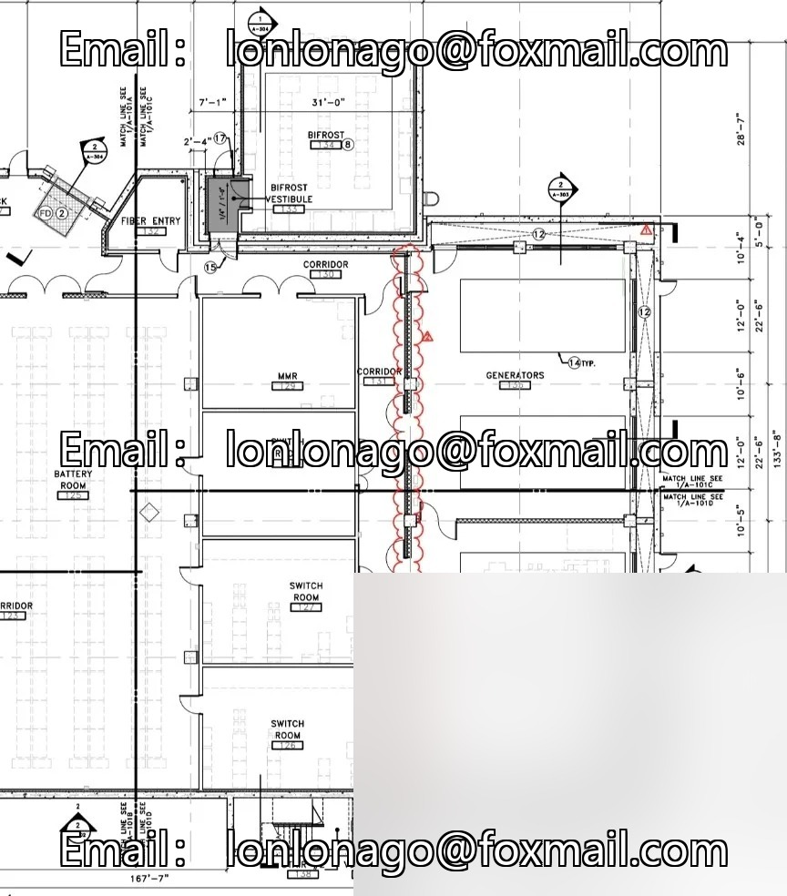
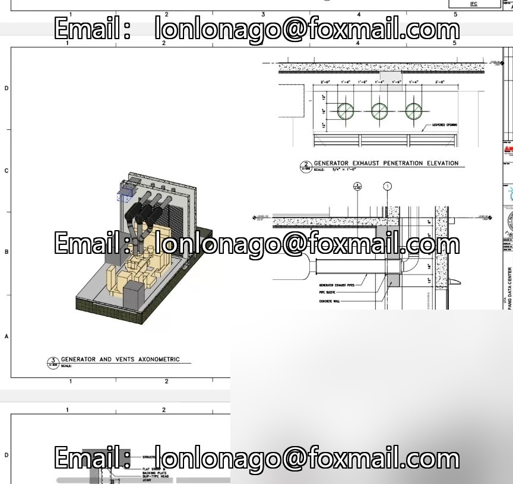

# Guam HDC1 data center design materials

## Body

Guam HDC1 Data Center Design Materials
Guam Arupan Data Center (HDC1) Comprehensive Drawing Catalog and Master Drawings
PDF 100 pages
GTA Arupan Data Center is the first Tier 3-level, 4MW edge computing data center and sea cable landing station integration facility in Guam. It is known for "resisting Category 5 typhoons, seismic Zone 4, above the 22-foot high water level, and 5-day fuel reserves," and is a hub for cross-Pacific sea cables and computing networks in the Western Pacific, a core infrastructure of Guam's digital ecosystem.

221110

The material provides design drafts and overview plans for the Guam HDC1 data center, including a PDF catalog of comprehensive drawings; the image shows geographic coordinates, marine facilities, electrical wiring and equipment layouts.

<!-- AI_ENRICHED -->

## Images

## Payment

Here is a pay link on Stripe ( https://buy.stripe.com/3cs8yP7sY87d0vu9AB ). Please contact me lonlonago@foxmail.com after funding $89, and I will send you a complete data files , thank you!

